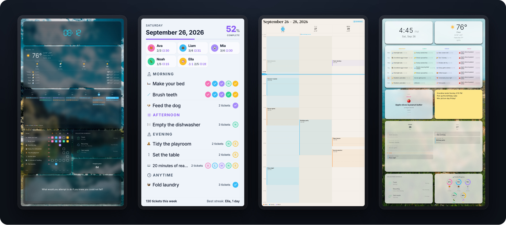
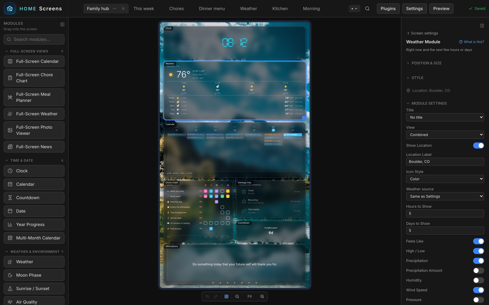
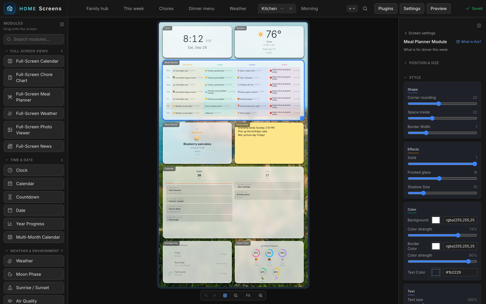
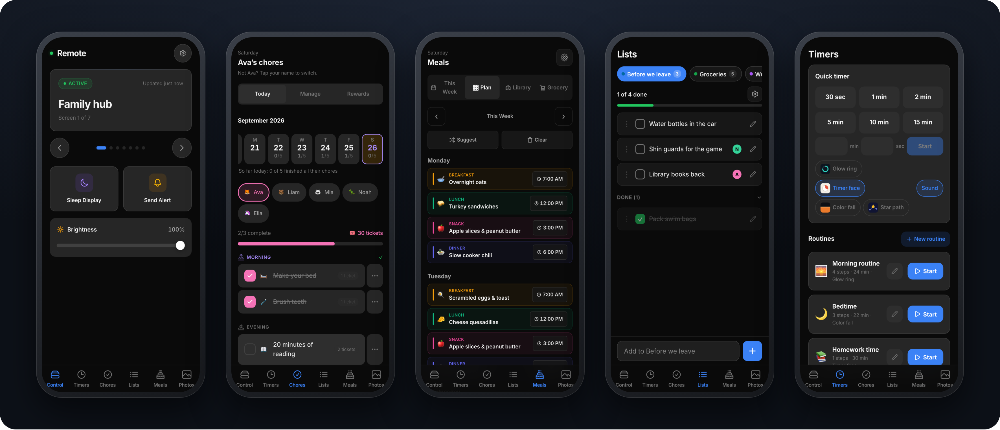

<p align="center">
  
</p>

<p align="center">
  <a href="https://discord.gg/9VyEasG5w"></a>
</p>

# Home Screens

An open-source smart display system built with Next.js. Runs on a Raspberry Pi in Chromium kiosk mode: a fully self-hosted, web-based replacement for Dakboard and MagicMirror.

## Screenshots









## Features

- **46 built-in modules**: clock (18 views), calendar (6 views), weather (14 views), countdown, dad jokes, text (rich with gradient/marquee), image, video (library file, direct URL, or YouTube link), quote, to-do list (5 views), family notes board (22 views, including chalkboard, letterboard, neon and newspaper looks), sticky note, greeting, news, stock ticker, crypto, word of the day, this day in history, moon phase, sunrise/sunset, photo slideshow (photos, videos, or both), QR code (custom + WiFi), year progress, traffic/commute, sports scores (15 leagues, your teams first), air quality, todoist, rain map, multi-month calendar, garbage day, standings (15 leagues), affirmations (4 views), date (5 views), display control (touch widget for wake/sleep/brightness/navigation), meal planner (5 views), chore chart (7 views), school timetable (2 views), iframe, icon (Font Awesome picker), shape & divider (15 views), and 6 fullscreen modules: fullscreen calendar (9 views), fullscreen weather (8 views), fullscreen news (2 views), fullscreen chore chart (5 views), fullscreen meal planner (4 views), and fullscreen photo viewer
- **Drag-and-drop editor**: visually arrange modules on a configurable canvas
- **Multi-screen rotation**: cycle through screens with 7 transition effects, or none
- **Multi-display hub-and-spoke**: one hub Pi can drive several physical displays, each with its own screens, dimensions, rotation, and active profile; spoke Pis are adopted from the editor and can be targeted individually from `/remote`
- **9 weather providers**: OpenWeatherMap, WeatherAPI, Pirate Weather, NOAA (free, US), Open-Meteo (free, global), Yr.no (free, global), SMHI (free, Nordic), Met Office (free, UK), Environment Canada (free, Canada)
- **Plugin system**: add new modules from the **Plugins** panel in the editor, or from a link with **Install from URL**; browse them in the [plugin directory](https://homescreens.dev/plugins) or build your own from the [template](https://github.com/home-screens/home-screens-plugin-template)
- **Profile system**: named screen groups with schedule-based auto-activation
- **Remote display control**: wake, sleep, brightness, navigation, and alerts via HTTP
- **Visual timers & routines**: start a quick timer or a saved routine (get dressed, brush teeth, shoes on) from your phone and it takes over the display with one of 4 kid-friendly countdown views, step-by-step, with an optional chime and a celebration at the end
- **Family organizer**: chores and rewards (start from a list of ready-made chores, bonus chores kids can grab, a rewards store), the meal planner and grocery list, shared to-do lists, and a notes board that clears itself, all run from the family remote on your phone, plus school timetables; one family list names everyone across chores, calendars, lists and timetables, and you can add your own pictures as icons
- **Touch-friendly display**: swipe left or right to change screens, tap a calendar event for its details, tap chores done, all on the display itself
- **Per-module scheduling**: show or hide modules by day of week and time window
- **Conditional module visibility**: show or hide any module based on live values such as the weather (hide the rain map on dry days), your calendar (busy now, events today), or anything a plugin publishes (e.g. a Home Assistant sensor), with and/or/not condition logic in the editor
- **Google Calendar, iCloud + iCal**: display events from Google Calendar (sign in with a short code, no Google setup needed), your iCloud calendars (sign in with an app-specific password, contact birthdays included), or any iCal/ICS feed
- **Background management**: upload images and videos, browse Unsplash or NASA APOD, pull from an Immich library, an iCloud shared album or a OneDrive folder, or import hand-picked photos from Google Photos, with auto-rotation
- **Per-module styling**: opacity, blur, colors, fonts, border radius, padding
- **System management**: upgrade, rollback, backup/restore, power control, and network settings (WiFi scan/connect, IP/hostname, diagnostics) from the UI
- **Raspberry Pi kiosk**: one-command setup with boot splash, auto-login, and display orientation
- **Password-protected editor**: optional authentication for the configuration interface
- **Multi-language UI**: ships in 7 languages (English, German, French, Spanish, Dutch, Brazilian Portuguese, and Danish); date and number formatting can be locked to a separate locale
- **Updates your way**: stay on tested releases or opt into early access or beta builds, get a note in the editor and on the phone when one is out, or let it install itself at a set time each day
- **No cloud required**: all data stored locally as JSON, no accounts or external services needed

## Quick Start

### Raspberry Pi: pre-built image

The fastest path. Flash the latest `.img.xz` from [Releases](https://github.com/home-screens/home-screens/releases) with Raspberry Pi Imager, drop a `wifi.txt` on the boot partition if you are not on Ethernet, and power on. About 10 minutes of hands-on work and no terminal. Step-by-step in [Getting Started](https://homescreens.dev/docs/getting-started).

Images ship for major and minor releases. For a patch release, or an existing Pi OS install, use the script below.

### Raspberry Pi: install script

Built for [Raspberry Pi OS Lite 64-bit (Trixie)](https://www.raspberrypi.com/software/operating-systems/). Desktop also works.

```bash
curl -fsSL https://raw.githubusercontent.com/home-screens/home-screens/main/scripts/install.sh | bash
```

Or clone first if you would rather read the script before you run it. From a clone, the options are:

```bash
sudo apt install git
git clone https://github.com/home-screens/home-screens.git

# Raspberry Pi OS Lite (default)
~/home-screens/scripts/install.sh

# Raspberry Pi OS with Desktop
~/home-screens/scripts/install.sh --desktop

# Custom port (default is 3000)
~/home-screens/scripts/install.sh --port 8080

# Pin a specific release tag instead of the latest
~/home-screens/scripts/install.sh --version v1.3.0

# Take the defaults instead of prompting for display settings
~/home-screens/scripts/install.sh --non-interactive

# Display-only spoke (no Node, kiosk only, points at a hub Pi)
~/home-screens/scripts/install.sh --display-only --backend http://home-screens.local:3000
```

Every flag works with the piped form too, using `bash -s --`:

```bash
curl -fsSL https://raw.githubusercontent.com/home-screens/home-screens/main/scripts/install.sh | bash -s -- --desktop
```

The script installs Node.js 22, Chromium, system dependencies, creates the systemd service, and configures the kiosk with display orientation. Reboot to start:

```bash
sudo reboot
```

### Running in Docker (community, limited)

The Docker image runs the Home Screens server so any browser on your network can be a display. It is for people who don't use a Raspberry Pi as their hub.

```bash
cp compose.example.yaml compose.yaml   # adjust the time zone, folders and user
docker compose up -d --build
```

Then open `http://<your-server>:3000/editor`.

**What works:** the editor, the phone remote, every module, plugins, backups, and any browser (a laptop, tablet or TV) as a display.

**What doesn't work in Docker.** These settings only make sense on a Raspberry Pi and will fail or do nothing:
- Update, roll back, and automatic updates
- Restart and reboot
- WiFi, hostname and network settings
- Turning the screen off, and screen rotation (set these on the device showing the display)
- Hardware stats

**Updating:** stop the container, copy your `data` and `backgrounds` folders somewhere safe, rebuild or pull the image, and start it again. Your settings upgrade themselves on first start. Don't go back to an older version without restoring the copy you made: older versions can't always read settings saved by newer ones.

**Tips**
- Keep both folders on volumes: `data` holds everything you set up, `backgrounds` holds your pictures and videos.
- The container runs as user 1000. If saving fails with a permission error, make the folders owned by that user or run the container as their owner.
- Names ending in `.local` (like `homeassistant.local`) often don't resolve inside containers. Use the IP address instead.
- If a reverse proxy sits in front, set `HS_TRUSTED_PROXIES` to its IP address.

### Local Development

```bash
git clone https://github.com/home-screens/home-screens.git
cd home-screens
npm install
npm run dev
```

Then visit:
- `http://localhost:3000/editor` to configure your screens
- `http://localhost:3000/display` for the fullscreen display view

## Configuration

API keys are managed in the editor at **Settings > API keys** (iCloud sign-ins live under **Settings > Calendar**). No `.env.local` file needed. Configuration is stored as a single JSON file (`data/config.json`), with no database.

### Google Calendar and Google Photos

No Google Cloud project needed: Home Screens brings its own Google app.

- **Calendar:** **Settings > Calendar > Sign in with Google**, enter the short code at `google.com/device` on any phone or computer, then tick the calendars to show.
- **Photos:** in a Photo Slideshow or Full-Screen Photo Viewer module, click **Sign in with Google**, approve, and the browser comes straight back to your hub. Then **Choose photos** opens Google's own picker.

Prefer your own Google app? Expand **Use your own Google app** on the Google card under **Settings > API keys**. Calendar takes a **TVs and Limited Input devices** OAuth client with the Google Calendar API enabled; Photos takes a **Web application** client with `https://homescreens.dev/connect/google` as its redirect URI and the Google Photos Picker API enabled. Then publish the app in the Google Cloud console (**Google Auth Platform > Audience > Publish app**): until you do, only the test users you list there can sign in, and Google ends every sign-in after 7 days. Google may then warn that it hasn't verified the app; it is your own, so choose **Advanced** and carry on. Once your own app is saved, a switch on the **Use your own Google app** row lets you go back to Home Screens' app without losing your details. Saving or switching apps signs Google out, so sign in again afterwards on the Calendar page or in the photo module.

### iCloud Calendar

Sign in with an **app-specific password**; no public sharing links needed:

1. Create an app-specific password at [account.apple.com](https://account.apple.com) > **Sign-In and Security > App-Specific Passwords**
2. In **Settings > Calendar > iCloud Calendar**, choose **Add iCloud account** and enter your Apple ID and the app-specific password (multiple accounts supported)
3. Pick which calendars to show. Apple's calendar colors carry over, and you can add a birthdays calendar built from your contacts

### iCal Feeds

Add any iCal/ICS URL in **Settings > Calendar**. It works with Outlook, Fastmail, and any service that provides an ICS subscription URL.

## Multi-Display Setup

Home Screens runs in two modes. A normal install is a single Pi that serves and renders its own display; nothing changes for that case, and the rest of this section is optional.

For more than one screen, pick one Pi as the **hub** (the one running Next.js) and install additional **spoke** Pis as kiosks pointed at it. Each display owns its own screens, dimensions, rotation, and active profile, so a portrait kitchen touchscreen and a landscape living-room TV can coexist on one hub without squashing each other.

### Add a spoke Pi

On the new Pi:

```bash
sudo apt install git
git clone https://github.com/home-screens/home-screens.git

# Install kiosk only: no Node.js, no server
~/home-screens/scripts/install.sh --display-only --backend http://home-screens.local:3000

# Or pin a specific display ID instead of the auto-generated one
~/home-screens/scripts/install.sh --display-only --backend http://hub:3000 --display-id kitchen
```

The `--display-only` flag installs just Chromium, labwc, wtype, wlr-randr, wlopm, kanshi, and fonts, with no Node.js and no release tarball. The Pi auto-generates a display ID from its hostname (e.g. `home-screens-hysd`) unless you pass `--display-id`. Reboot and it will boot straight to a "Connecting…" splash, then auto-launch into the real display URL the moment the hub answers.

### Adopt the spoke

On the hub, open the editor and go to **Settings > Per display > All displays**. Any spoke that's powered on and pointed at this hub shows up in the unadopted list; click to adopt it, give it a name, and pick its resolution and rotation. The display appears in the editor's **Display Switcher** pill in the toolbar so you can flip between which display you're editing, and in the sidebar's **Per display** group as its own drill-down page with Overview and Overrides sub-tabs.

Each display card has an **Edit screens** shortcut, an online/offline dot driven by live heartbeats, and the spoke's reported viewport (including its source IP), so you can tell which physical Pi is reporting at a glance.


## Managing the Pi

### SSH Access (Pre-Built Image)

| | |
|---|---|
| **Hostname** | `home-screens.local` |
| **Username** | `hs` |
| **Password** | `screens` |

```bash
ssh hs@home-screens.local
passwd  # change the default password
```

### Service Management

```bash
sudo systemctl start home-screens     # start the server
sudo systemctl stop home-screens      # stop server + kiosk
sudo systemctl status home-screens    # check status
journalctl -u home-screens -f         # view logs
```

### Backups

The editor has built-in backups at **Settings > Backups & data**. For a copy off the Pi:

```bash
# Settings, screens, keys, family, chores, meals, lists, timers, your icons, plugins
scp -r hs@home-screens.local:/opt/home-screens/current/data/ ./hs-backup/

# Uploaded photos and videos live outside data/
scp -r hs@home-screens.local:/opt/home-screens/current/public/backgrounds/ ./hs-backup/
```

Copy whole directories rather than picking out files. Some data is split across more files than you would guess: chore definitions and chore completions are separate, so grabbing only `chores.json` leaves every earned point behind. [Configuration](https://homescreens.dev/docs/configuration) lists every file and what writes it.

### Custom Port

Default is **3000**. Change during install (`--port 8080`) or afterward:

```bash
echo 8080 > /opt/home-screens/current/data/port.conf
bash /opt/home-screens/current/scripts/upgrade.sh setup-system
sudo reboot
```

### Display Resolution

From the editor: **Settings > Screen** (or, with more than one display, the main display's own page under **Per display**) sets the resolution and rotation. The picture changes straight away, with no reboot.

If you cannot reach the editor, turn the picture over SSH as the normal user (not with `sudo`):

```bash
bash /opt/home-screens/current/scripts/rotate-display.sh 90   # 0, 90, 180 or 270
```

Set the same rotation in the editor afterwards: the next update puts back whatever **Settings > Screen** says. Don't edit `data/kiosk.conf` by hand; Home Screens rewrites it from your settings.

### Forgot Password

```bash
home-screens-reset-password
```

Home Screens then opens without a password, and a new one can be set in
Settings > Security. On installs that predate the command, deleting the file
does the same thing:

```bash
rm /opt/home-screens/current/data/auth.json
```

## Documentation

Full documentation at **[homescreens.dev/docs](https://homescreens.dev/docs)**

- [Getting Started](https://homescreens.dev/docs/getting-started): installation and setup
- [What to Buy](https://homescreens.dev/docs/what-to-buy): the Pi, power supply, memory card and cable, about $90 plus a screen you may already own
- [Your First Screen](https://homescreens.dev/docs/first-screen): a template, your location, a calendar and a chore chart in about ten minutes
- [Editor Guide](https://homescreens.dev/docs/editor): visual editor walkthrough
- [Modules](https://homescreens.dev/docs/modules): overview of the 46 built-in modules
- [Module Reference](https://homescreens.dev/docs/module-reference): every setting, default value, and allowed option for each module
- [Weather](https://homescreens.dev/docs/weather): nine weather services, five free with no account, one location for every module
- [Calendars](https://homescreens.dev/docs/calendars): Google, iCloud, Outlook and any calendar link, with the right colors
- [Family](https://homescreens.dev/docs/family): the people in your home, and groups of them, shared by chores, calendars, lists and timetables
- [Chores and Rewards](https://homescreens.dev/docs/chores): chore charts kids tick off on the wall or a phone, bonus chores, and tickets to spend on rewards
- [Meals](https://homescreens.dev/docs/meals): the meal library, the weekly plan and the grocery list
- [Lists](https://homescreens.dev/docs/lists): shared to-do lists, added on your phone and ticked off anywhere
- [Notes](https://homescreens.dev/docs/notes): a family notes board, written on your phone, that takes each note down on its own when its time is up
- [School Timetable](https://homescreens.dev/docs/school-timetable): each child's school week, typed in or imported from a spreadsheet
- [Backgrounds](https://homescreens.dev/docs/backgrounds): uploads, the picture library, Unsplash, NASA APOD, Immich, iCloud, Google Photos, rotation
- [News](https://homescreens.dev/docs/news): headlines from any site, blog, YouTube channel or subreddit, plus a full-screen front page
- [Profiles & Scheduling](https://homescreens.dev/docs/profiles): automation and time-based layouts
- [Remote Control](https://homescreens.dev/docs/remote-control): the phone remote for display control, chores, meals, lists, notes, timers and photos
- [Multi-Display](https://homescreens.dev/docs/multi-display): hub-and-spoke setup for driving several displays from one Pi
- [Voice Control](https://homescreens.dev/docs/voice-control): drive displays, chores, and grocery lists from Home Assistant voice
- [Raspberry Pi](https://homescreens.dev/docs/raspberry-pi): kiosk deployment
- [Networking](https://homescreens.dev/docs/networking): reverse proxy, remote access, multi-display
- [Troubleshooting](https://homescreens.dev/docs/troubleshooting): common issues and fixes
- [API Reference](https://homescreens.dev/docs/api): all endpoints
- [Configuration](https://homescreens.dev/docs/configuration): JSON schema reference
- [Plugins](https://homescreens.dev/docs/plugins): installing Home Assistant, Garmin, Strava and more
- [Plugin Development](https://homescreens.dev/docs/plugin-development): building your own module
- [Development](https://homescreens.dev/docs/development): architecture and contributing
- [FAQ](https://homescreens.dev/docs/faq): frequently asked questions

## Architecture

```mermaid
graph TB
    subgraph Clients
        Editor["Editor<br/>(browser)"]
        Display["Display(s)<br/>(1 hub or N spoke kiosks)"]
    end

    subgraph "Next.js Server (hub)"
        API["API Routes"]
        ConfigAPI["/api/config"]
        DisplaysAPI["/api/displays<br/>(read-only registry)"]
        DisplayAPI["/api/display/*<br/>(commands + status)"]
        SecretsAPI["/api/secrets"]
        PluginProxy["/api/plugins/proxy"]
        StatusMap["statusMap<br/>(in memory)"]
    end

    subgraph "Local Storage"
        Config["data/config.json"]
        Secrets["data/secrets.json"]
        Meals["data/meals.json"]
        Plugins["data/plugins/"]
        Tokens["data/plugin-tokens/"]
    end

    subgraph "External Services"
        Weather["Weather Providers<br/>(OWM, WeatherAPI, Pirate Weather,<br/>NOAA, Open-Meteo, Yr.no, SMHI,<br/>Met Office, Environment Canada)"]
        ESPN["ESPN<br/>(scores, standings)"]
        Google["Google<br/>(Calendar, Photos Picker, Routes)<br/>sign-in via auth.homescreens.dev"]
        Other["RSS, CoinGecko,<br/>Yahoo Finance, etc."]
    end

    Editor -- "Zustand store<br/>PUT /api/config<br/>(adoption writes here)" --> ConfigAPI
    Editor -- "GET registry +<br/>unadopted Pis" --> DisplaysAPI
    Editor -- "queue commands" --> DisplayAPI
    ConfigAPI -- "read / write" --> Config
    DisplaysAPI -- "read" --> Config
    Display -- "GET /api/config<br/>(filtered per display)" --> ConfigAPI
    Display -- "poll commands<br/>POST status + viewport" --> DisplayAPI
    DisplayAPI -- "heartbeats stay in RAM,<br/>never touch config.json" --> StatusMap
    DisplaysAPI -. "merges live status" .-> StatusMap
    API -- "read keys" --> Secrets
    API -- "read / write" --> Meals
    SecretsAPI -- "read / write" --> Secrets
    PluginProxy -- "load manifest" --> Plugins
    PluginProxy -- "read" --> Tokens
    PluginProxy -- "inject keys + tokens" --> Other
    API --> Weather
    API --> ESPN
    API --> Google
    API --> Other
```



## Tech Stack

- Next.js 16 / React 19 (App Router)
- Tailwind CSS v4
- @dnd-kit (drag-and-drop)
- Zustand (editor state)
- Vitest (testing)

## API Routes

External services are reached through server-side API routes, so credentials never reach the browser. See the [API Reference](https://homescreens.dev/docs/api) for the full endpoint list.

## Adding a Module

A module is a component, a registry entry, and an E2E fixture. Full walkthrough in the [Development docs](https://homescreens.dev/docs/development).

Or build it as a [plugin](https://homescreens.dev/docs/plugins), with no core changes required.

## License

[MIT](LICENSE)
