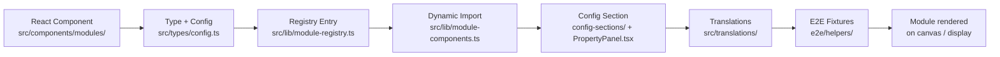
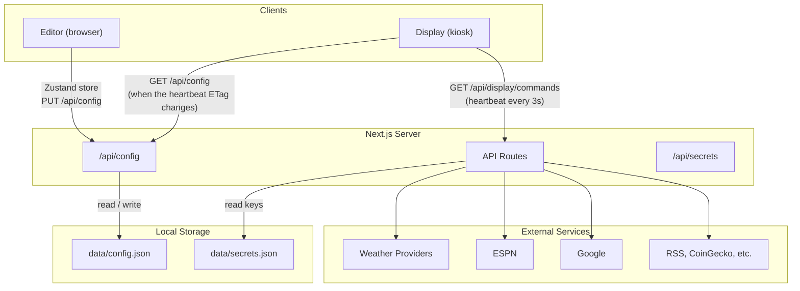

## Project Structure

```
src/
  app/
    (display)/display/       # Fullscreen kiosk view
    (editor)/editor/         # Configuration editor
    (auth)/login/            # Login page
    (connect)/editor/connect/google/  # Where a Google Photos or Google Calendar (adding events) sign-in returns to the hub
    (remote)/remote/         # Phone remote
    (remote)/chores/         # The kids' chore page
    api/                     # API routes (see API Routes section below)
  components/
    modules/                 # All 47 module components + ModuleWrapper
    display/                 # ScreenRotator, ScreenRenderer, SleepOverlay
    editor/                  # Canvas, palette, property panel, settings, backgrounds
    ui/                      # Shared UI primitives (Button, Slider, Toggle, ColorPicker)
  hooks/                     # Custom React hooks
  i18n/                      # i18n runtime (provider, loader, manifest, formatters)
  lib/                       # Core logic (config, weather, calendar, registry, etc.)
  stores/                    # Zustand state management
  translations/              # One folder per locale: core, editor, modules, remote, weather
  types/                     # TypeScript type definitions
data/                        # All runtime state; never committed
  config.json                # Live configuration file
  secrets.json               # API keys
  meals.json                 # Meal planner state + shared settings
  todos.json                 # Shared to-do lists
  notes.json                 # Family notes board
  day-notes.json             # Day notes drawn on the calendars
  family.json                # Shared household identities and aliases
  chores.json                # Chore definitions (member IDs refer to family.json)
  chore-completions.json     # Completion history
  rewards.json               # Rewards and member ticket balances
  family-transaction.json    # Pending durable transaction; removed after verification
  family-migration.json      # First migration evidence
  family-migrations/         # Immutable evidence from later legacy folds
  icloud-accounts.json       # iCloud CalDAV credentials
  plugins/                   # Installed plugin bundles + installed.json
  plugin-secrets/            # Per-plugin secret stores
  plugin-tokens/             # Per-plugin auth tokens
public/
  backgrounds/               # The picture and video library (uploads, imports, starter backgrounds)
e2e/                         # Playwright suite + fixture registries
scripts/                     # Install, deploy, and management scripts
website/                     # Marketing site + these docs (separate Next.js app)
infrastructure/              # Cloudflare workers: Google sign-in helper, telemetry, version check
```

The `@/` import prefix resolves to `src/` (tsconfig `paths`, mirrored in `vitest.config.ts`), so `@/lib/config` means `src/lib/config`.

## Architecture

### Route Groups

The app uses Next.js route groups to separate concerns:

- `(display)`: no layout chrome, just the fullscreen display
- `(editor)`: includes toolbar, sidebars, and editor controls
- `(auth)`: login and authentication pages
- `(connect)`: the page a Google Photos or Google Calendar (adding events) sign-in comes back to, behind the editor login but outside the editor layout
- `(remote)`: mobile remote control and the kid-facing `/chores` page

### Module System

There are currently ** modules** organized into  categories:

| Category | Modules |
|---|---|
| **Full-screen views** | fullscreen-calendar, fullscreen-chore-chart, fullscreen-meal-planner, fullscreen-weather, fullscreen-photo, fullscreen-news |
| **Time & date** | clock, calendar, countdown, date, year-progress, multi-month, quick-timer |
| **Weather & environment** | weather, moon-phase, sunrise-sunset, air-quality, rain-map |
| **News & finance** | news, stock-ticker, crypto, sports, standings |
| **Knowledge & fun** | dad-joke, quote, word-of-day, history |
| **Personal** | todo, notes, sticky-note, greeting, todoist, garbage-day, affirmations, meal-planner, chore-chart, timetable |
| **Health & fitness** | *(no built-ins; reserved for plugins such as Strava and Garmin. The palette hides the category while it is empty.)* |
| **Media & display** | text, image, video, photo-slideshow, qr-code, iframe, icon, shape, display-control |
| **Travel** | traffic |

The module system follows a registry pattern. Each module is a self-contained unit, wired together in sequence:



Each module requires seven pieces, plus an optional API route:

1. React Component (`src/components/modules/MyModule.tsx`)
2. `BuiltinModuleType` union member and config interface (`src/types/config.ts`)
3. Registry entry (`src/lib/module-registry.ts`), this is also where `defaultSize` lives
4. Dynamic import (`src/lib/module-components.ts`)
5. Config section component + a `CONFIG_SECTIONS` entry (`src/components/editor/config-sections/`, `PropertyPanel.tsx`)
6. Translation keys in every shipped locale (`src/translations/<locale>/editor.json` and `modules.json`)
7. E2E fixture rows (`e2e/helpers/`), the `meta` coverage checks fail the suite for any module type without them
8. (Optional) API route (`src/app/api/*/route.ts`)

Steps 1 through 8 are walked through in [Adding a New Module](#adding-a-new-module) below. The one full checklist, with the places tsc and `npm test` catch rather than the `meta` project, is `src/components/modules/CLAUDE.md`.

### State Management

- **Editor**: Zustand store (`src/stores/editor-store.ts`) manages config, selection, and dirty state
- **Display**: config rendered by the server, then fetched again only when the heartbeat reports a new config ETag (no Zustand needed)

### Data Flow



#### Editor Flow

User interactions flow through the editor canvas, which dispatches actions to the Zustand store. The store saves changes via `PUT /api/config`, which writes to `data/config.json`.

#### Display Flow

The display reads `data/config.json` via `GET /api/config`, fetching it again whenever its 3-second heartbeat (`GET /api/display/commands`) says the config changed. The `ScreenRotator` selects the active screen, and the `ScreenRenderer` lays out modules, rendering a `ModuleMount` (`src/components/display/ModuleMount.tsx`) for each one: it finds the component, resolves its props and style, and wraps it in an error boundary. Each module then draws its own card with `ModuleWrapper`.

When `config.displays` is populated, the global `config.screens` is no longer the source of truth: each `DisplayNode` in that array owns its own `screens`, dimensions, and optionally its own profiles, and the server filters the config down to the requesting display before rendering. With `config.displays` unset the app stays in single-display mode and reads `config.screens` directly. See [Multi-Display](/docs/multi-display).

#### API Data Flow

Module components use the `useFetchData` hook to call API routes (e.g., `/api/weather`, `/api/calendar`), which in turn fetch data from external services (OpenWeatherMap, Google, ESPN, etc.).

### Weather Provider Abstraction

Weather data comes from a pluggable provider system in `src/lib/weather/`.

The `WeatherProvider` interface defines four methods: `getHourly`, `getForecast`, and optionally `getMinutely` and `getAlerts`.  implementations exist:

- **OpenMeteoProvider**: free, no API key, global coverage; provides hourly and forecast data (the default)
- **NOAAProvider**: free, no API key, US only; provides hourly, forecast, and alerts
- **YrProvider**: free, no API key, global; provides hourly and forecast data (Norwegian Meteorological Institute)
- **SMHIProvider**: free, no API key, Nordic coverage; provides hourly and forecast data (Swedish Meteorological and Hydrological Institute)
- **EnvCanadaProvider**: free, no API key, Canadian cities; provides hourly and forecast data (ECCC citypage feeds)
- **MetOfficeProvider**: **requires an API key** (free tier on the Met Office DataHub Site-Specific API), UK coverage; provides hourly and forecast data. The constructor throws when no key is configured.
- **OpenWeatherMapProvider**: requires API key; provides hourly and forecast data
- **WeatherAPIProvider**: requires API key; provides hourly and forecast data
- **PirateWeatherProvider**: requires API key; provides hourly, forecast, minutely precipitation, and alerts (Dark Sky replacement)

The factory function `createWeatherProvider(provider, apiKey)` instantiates the correct one. The key-less providers cover most use cases: Open-Meteo is the global default; NOAA, Yr.no, SMHI, and Environment Canada provide higher-accuracy regional forecasts within their coverage areas. The key-required providers (Met Office, OpenWeatherMap, WeatherAPI, and Pirate Weather) round out the options when a user wants a specific data source. Pirate Weather is the only one that provides minutely precipitation data.

A fresh install does not ship coordinates: `settings.latitude` and `longitude` seed to `0`, so the weather module returns nothing useful until a location is set in the editor's location settings. The default provider needs no key, but it does need a location.

### API Routes

API routes live in `src/app/api/*/route.ts` and serve as server-side proxies for external services. There are  route files; the table below groups them by area. The [API Reference](/docs/api) documents the ones scripts and home automation call and lists every route with the access it needs, generated from the route files. For the rest, the route file is the reference.

| Category | Routes | Purpose |
|---|---|---|
| **Auth** | `auth/login`, `auth/logout`, `auth/status`, `auth/password`, `auth/display-token`, `auth/revoke-sessions`, `auth/ip-allowlist`, `auth/google/*`, `grown-up-code*` | Authentication, session management, display key, IP allowlist, Google sign-in (the Calendar device code, the web sign-in for adding events and its return, which app signs in), and the grown-up code and its unlocks |
| **System** | `system/status`, `system/version`, `system/build-id`, `system/changelog`, `system/power`, `system/upgrade`, `system/rollback`, `system/backups`, `system/update-notification`, `system/timezone`, `system/sudo-grant`, `system/stats`, `system/diagnostics`, `system/address`, `health` | Server management and deployment, the device clock's time zone, the passwordless-sudo repair, status and diagnostics, the hub's LAN address for a kiosk running on the hub, and a public is-it-up check |
| **Config** | `config`, `secrets*`, `backup`, `backup/upload`, `backup/archive`, `backup/pictures`, `backup/credentials`, `backup/reminder`, `backup/auto*`, `backup/latest` | Read/write config, manage API keys and the set-up services that need attention, backups (JSON, or a zip with pictures), automatic backups and their private download link |
| **Weather** | `weather`, `weather/check-key`, `rain-map` | Weather data ( providers), checking a saved key, and rain radar tiles |
| **Calendar** | `calendar`, `calendar/status`, `calendar/check`, `calendar/entry`, `calendar/events*`, `calendar/appearance`, `calendars`, `day-notes*`, `icloud/accounts`, `icloud/calendars`, `holidays` | Events from every calendar source and per-source health, checking an iCal link before it is saved, adding, changing and removing events, recolouring a calendar from the wall, day notes, iCloud CalDAV accounts and calendars, holiday feeds |
| **Data** | `jokes`, `quote`, `news`, `history`, `stocks`, `crypto`, `sports`, `sports/team`, `sports/teams`, `standings`, `todoist*`, `air-quality`, `traffic` | External data proxies |
| **Family data** | `family`, `family/groups`, `chores`, `chores/data`, `chores/today`, `chores/grab`, `chores/skip`, `chores/put-back`, `chores/settings`, `rewards`, `rewards/data`, `rewards/goal`, `rewards/ledger`, `meals/*`, `mealie/*`, `timers/routines`, `timers/session`, `todo/lists*`, `notes*`, `timetables*` | The family roster and groups, and local chore, reward, meal-plan (with the Mealie recipe library), timer-routine, to-do list, notes board and school timetable state |
| **Displays** | `displays`, `display/[action]`, `display/claim`, `display/walls*`, `display/hw-stats`, `display/console-log`, `display/kiosk-bundle`, `display/kiosk-bootstrap`, `display/power-state` | Display registry and heartbeats, remote control, letting wall browsers in, hardware telemetry, log capture, kiosk self-update bundle for display-only Pis, screen power for the kiosk's power helper |
| **Plugins** | `plugins/registry`, `plugins/installed`, `plugins/install`, `plugins/install-external`, `plugins/manifest/*`, `plugins/bundle/*`, `plugins/asset/*`, `plugins/dev`, `plugins/migrate-config`, `plugins/proxy/*`, `plugins/secrets/*`, `plugins/settings/*`, `plugins/auth/*` | Plugin registry, install lifecycle, asset serving, API proxy, secrets, settings, server-side auth |
| **Network** | `system/network`, `system/network/wifi/*`, `system/network/hostname`, `system/network/ip`, `system/network/confirm`, `system/network/diagnostics` | Wi-Fi scan and connect, hostname, static IP, and connectivity checks |
| **Photos** | `photo-source/media`, `photo-source/browse`, `photo-source/import`, `google-picker/auth`, `google-picker/session`, `google-picker/import`, `google-picker/status`, `immich/*`, `onedrive/*`, `icloud/import`, `icloud/serve`, `icloud/video`, `art/*` | One media list for every photo source, browsing and copying one picture, the Google Photos Picker import, the Immich, OneDrive and iCloud pieces (connection checks, picture and video proxies, sign-in, import), and the museum paintings (the one a wall is showing, **Don't show again**) |
| **i18n** | `i18n/[locale]` | Serves locale dictionaries by namespace |
| **Media** | `backgrounds`, `backgrounds/inventory`, `backgrounds/directories`, `backgrounds/move`, `backgrounds/pair-live`, `backgrounds/rotate`, `backgrounds/serve`, `custom-icons`, `custom-icons/[id]`, `custom-icons/serve`, `backup/custom-icons` | The shared picture and video library, pairing Live Photos, background rotation, and the family's own icons |
| **Utility** | `geocode`, `image-proxy`, `time` | Geocoding, image proxying, server time |

### Display Control

Remote control uses a command queue pattern where the editor (or any HTTP client) pushes commands and the display polls to execute them.

**Command flow:** The client sends a POST request (e.g., `POST /api/display/wake`), which enqueues the command in memory. The display polls `GET /api/display/commands`, which drains the queue and returns pending commands. The display then executes each command locally.

**Status reporting:** The display periodically sends `POST /api/display/status` with its current state (screen index, screen name, display state, etc.). The editor can then read the display status via `GET /api/display/status`.

**Display targeting:** Every action resolves a target from `?display=<id>`, so the full form is `/api/display/<action>?display=<id>`. Command-enqueue actions accept `all` to broadcast to every display that has checked in; `status`, `profile`, `module-enabled`, `goto-screen` and the reads reject it. A call that names no display goes to the main display (`findMainDisplay`) once `config.displays` exists, and to the legacy `__default__` queue on a single-display install. A wall's own command drain and status report are never resolved this way: they always name the display they come from. Command queues are keyed by display id in `src/lib/display-commands.ts`, and heartbeats live in an in-memory `statusMap` rather than `config.json`, so status posts never contend with editor saves. See [Multi-Display](/docs/multi-display) for the rest.

### Auth System

An authentication layer (`src/lib/auth.ts`) protects the editor and API routes. Google OAuth device flow is used for Google Calendar integration via `auth/google/device`.

**Password auth:** The browser sends `POST /api/auth/login` with a password, and the API responds with a session cookie.

**Google OAuth device flow:** The browser requests a device code via `POST /api/auth/google/device`, which returns a `user_code` and `verification_url`. The user enters the code at `google.com/device`. The browser polls `PUT /api/auth/google/device` until the authorization is complete, at which point tokens are stored on disk.

**Adding events:** writing to Google Calendar takes Google's web sign-in rather than the device code. `GET /api/auth/google/web` builds the link (`{ url, returnsToHub }`), and `POST /api/auth/google/web` redeems a pasted code or link. A code that comes back through the hub's return page (`/editor/connect/google`) goes to `POST /api/auth/google/return`, which Google Photos import shares. The rules both sign-ins share are in `src/lib/google-web-sign-in.ts`: one sign-in waits at a time, in memory, for 10 minutes; its `state` carries a one-time value (plus the hub's address when it could be confirmed) that must match when the code comes back; and PKCE (S256) means Google refuses the code without the hub's verifier, which never leaves the hub. Home Screens' own Google app needs the wider "View and edit events" sign-in that Google has to review first, so on that app adding events stays off until `HS_GOOGLE_HOSTED_EVENTS=1` (`src/lib/google-hosted.ts`); a household's own app needs only a saved **Web application** client.

**Which Google app signs in:** out of the box the hub uses Home Screens' own Google apps (`src/lib/google-hosted.ts`). The client ids are public; the secrets live only in the sign-in helper in `infrastructure/google-oauth-worker/`, which the hub sends its token requests to and which adds the secret on the way to Google. A household that saved its own client under `google_client_id` / `google_web_client_id` uses that instead, unless it flipped the switch on the API keys card (`settings.googleApp: "hosted"`); `chooseGoogleApp` in `src/lib/google-app-choice.ts` is the one rule for both the token stores and the card. `HS_GOOGLE_HOSTED=0` turns the hosted apps off. To develop against a local helper, run `wrangler dev` in `infrastructure/google-oauth-worker` and set `HS_GOOGLE_CALENDAR_TOKEN_URL` and `HS_GOOGLE_PHOTOS_TOKEN_URL` to its token URLs.

### Profile & Schedule System

Profiles group screens together and can activate on a schedule. Individual screens and modules also support their own scheduling so they can show/hide by day and time independent of profiles.

**Profile structure:** Each profile has an `id`, `name`, a list of `screenIds`, and an optional `schedule` (with `daysOfWeek`, `startTime`, `endTime`, and `invert` fields).

**Screen schedule:** Each screen can define an optional `schedule` (same `ModuleSchedule` shape as profiles and modules). Scheduled-off screens are filtered out of the rotation pool *before* profile resolution, so a profile that explicitly references a hidden screen still skips it. If every screen has a schedule and none currently match, the rotator falls back to all enabled screens so the kiosk never goes blank.

**Module schedule:** Each module can define a schedule with `daysOfWeek` (0=Sun through 6=Sat), `startTime`, `endTime`, and an `invert` flag (hide during the window if true).

**Screen resolution order:** Screens are first filtered by their own schedules, then profile resolution runs against the remaining set. If a scheduled profile matches the current time, the first matching profile wins; otherwise the manually selected `activeProfile` is used; otherwise all (schedule-filtered) screens rotate. Within each visible screen, modules are then filtered by their individual schedules.

## Adding a New Module

### 1. Create the component

```tsx
// src/components/modules/MyModule.tsx
'use client'

interface MyModuleProps {
  config: { myOption: string }
}

export default function MyModule({ config }: MyModuleProps) {
  return <div>{config.myOption}</div>
}
```

The component receives its `config` and `style` as props, and every module also gets `timezone`, `fullscreenTheme` and `timeFormat`. Anything more is decided by the `dataRequirements` array on your registry entry (step 3), not by a lookup table: `'location'` adds `latitude` and `longitude`; `'weather'` adds those plus `hourly`, `forecast`, `minutely`, `alerts`, `units` and `locationName`; `'calendar'` adds `events` and the related calendar props (`people`, `groups`, `calendarOrder`, `swatches` and the loading and status props). There is no `settings` prop. `buildModuleProps` in `src/lib/module-props.ts` wires these props, called from `ModuleMount.tsx` on the wall and `DraggableModule.tsx` on the editor canvas, and `useSharedDisplayData.ts` reads the same field to decide which weather sources to fetch.

User-visible strings belong in `src/translations/<locale>/modules.json` and are read with `useTranslate('modules')` from `@/i18n`, not hard-coded in the component. See step 6.

### 2. Add the type

In `src/types/config.ts`, add to the `BuiltinModuleType` union:

```typescript
export type BuiltinModuleType =
  | 'clock'
  | 'calendar'
  // ...
  | 'my-module'
```

And define the config interface:

```typescript
export interface MyModuleConfig {
  /** The words the module shows */
  myOption: string
}
```

Give every field a JSDoc comment (the first paragraph is shown on the website, so keep it plain), then run `npm run docs:schema`; `npm test` fails while `website/content/generated/schema.json` is stale.

### 3. Add the registry entry

Built-in modules are literal entries in the `MODULE_DEFINITIONS` array in `src/lib/module-registry.ts`. Import your Lucide icon at the top of that file and add an object to the array, inside the block for your category:

```typescript
import { Sparkles } from 'lucide-react'

// ...inside const MODULE_DEFINITIONS: ModuleDefinition[] = [ ... ]
{
  type: 'my-module',
  label: 'My Module',
  icon: Sparkles,
  category: 'Personal',
  defaultConfig: { myOption: 'Hello' },
  defaultSize: { w: 400, h: 300 },
  // defaultStyle: { fontSize: 26 },      // optional style overrides
  // fillsCanvas: true,                   // optional: snaps to the full canvas on add
  // dataRequirements: ['weather'],       // optional: 'location' | 'weather' | 'calendar'
},
```

There is no `registerModule()` API to call. `registerPluginModule()` is exported, but it is for runtime-loaded plugins only; built-ins never use it.

`defaultSize` lives here, on the entry. It used to live in `src/lib/constants.ts`; that map is gone, and anything needing a module's default size calls `getModuleDefinition(type).defaultSize` so plugin-registered modules resolve through the same lookup.

The `label` field is a fallback used for plugin modules. Built-in labels come from the translation dictionaries instead; see step 6.

### 4. Add the dynamic import

In `src/lib/module-components.ts`:

```typescript
'my-module': dynamic(() => import('@/components/modules/MyModule')),
```

### 5. Add editor controls

Config controls are one small component per module type, under `src/components/editor/config-sections/`. Three edits:

**(a) Create the section component.** `AirQualityConfigSection.tsx` is a short model to copy. Props are `{ mod, screenId }`; read and write config with `useModuleConfig(mod, screenId)`, and label everything through `useTranslate('editor')` against `configSections.<type>.*` keys.

```tsx
// src/components/editor/config-sections/MyModuleConfigSection.tsx
'use client'

import { useModuleConfig } from '@/hooks/useModuleConfig'
import { useTranslate } from '@/i18n'
import type { ModuleInstance } from '@/types/config'

export function MyModuleConfigSection({ mod, screenId }: { mod: ModuleInstance; screenId: string }) {
  const t = useTranslate('editor')
  const { config: c, set } = useModuleConfig<{ myOption?: string }>(mod, screenId)

  return (
    <input
      value={c.myOption ?? ''}
      placeholder={t('configSections.my-module.myOption')}
      onChange={(e) => set({ myOption: e.target.value })}
    />
  )
}
```

**(b) Re-export it** from `src/components/editor/config-sections/index.ts`.

**(c) Register it** in `src/components/editor/PropertyPanel.tsx`:

```typescript
export const CONFIG_SECTIONS: Record<BuiltinModuleType, ConfigSectionFC> = {
  // ...
  'my-module': MyModuleConfigSection,
}
```

Step (c) is compiler-enforced: `CONFIG_SECTIONS` is an exhaustive `Record` keyed by `BuiltinModuleType`, so a module type added without an entry fails `npx tsc --noEmit` rather than silently rendering an empty property panel.

### 6. Add translations

Built-in module names and config labels come from the dictionaries, not from the registry `label`. Add:

- `registry.types.my-module` in `src/translations/<locale>/editor.json`, which is the name shown in the palette, property panel, canvas, and template picker
- `registry.descriptions.my-module` (the palette's description of the module) and `registry.keywords.my-module` (extra words the palette search matches, never shown), also in `editor.json`
- any `configSections.my-module.*` keys your config section reads, also in `editor.json`
- any strings your display component renders, to `src/translations/<locale>/modules.json`

Do this for all  shipped locales. `src/i18n/manifest.ts` is the source of truth for which locales are registered. A missing key renders the raw dot path (`registry.types.my-module`) in the UI, and the `meta` E2E ratchets fail when a manifest locale is missing from a surface's i18n spec.

### 7. Add E2E coverage

The `meta` Playwright project holds coverage ratchets that fail the whole suite when a new module skips its registries. **Run it first**, because the failure output names the exact entries you need to add:

```bash
npx playwright test --project=meta
```

The registries it polices:

| Registry | File | Fails when |
|---|---|---|
| `MODULE_FIXTURES` | `e2e/helpers/module-fixtures.ts` | a built-in module type has no fixture row |
| `CONFIG_VARIANTS` | `e2e/helpers/config-variants/` | a config field has neither a variant row nor a reasoned `FIELD_DECISIONS` entry |
| `EXTRA_DISCRIMINATORS` | `e2e/meta/coverage.spec.ts` | a member of a mode-like string union goes untested |
| `DISCRIMINATOR_UNION_DECISIONS` | `e2e/meta/coverage.spec.ts` | a string union a module config uses is neither a `*View` union, an `EXTRA_DISCRIMINATORS` row, nor given a written reason here |
| `EMPTY_STATE_FIXTURES` / `EMPTY_STATE_PENDING` | `e2e/helpers/empty-state-fixtures.ts`, `e2e/meta/coverage.spec.ts` | a component using `ModuleEmptyState`, `LocationRequired` or `WeatherEmptyState` has neither a fixture row nor a pending entry with its reason |
| `ROUTE_DECISIONS` | `e2e/meta/coverage.spec.ts` | a new API route is neither E2E-exercised, nor unit-tested, nor given a written reason |
| Field-edit case | `e2e/editor/config-editing.spec.ts` | a built-in module type has no `buildModuleInstance('<type>')` edit test |
| `VIEW_MATRIX` / `SINGLE_VIEW_TESTED_MODULES` | `e2e/helpers/view-matrix.ts`, `e2e/meta/coverage.spec.ts` | a module with a `*View` union does not render every view |
| `AUTOSIZED_MODULES` | `e2e/helpers/autosized-modules.ts` | a component reaches `useScaledFontSize` or `useFitFontSize` without `autoSizesText` on its registry entry |
| `STYLE_EXEMPTIONS` | `e2e/helpers/style-matrix.ts` | an exemption from the style matrix (`e2e/display/module-style.spec.ts`) names a module or control the matrix does not probe, or gives no reason |
| `DEFAULT_FALLBACK_EXEMPTIONS` | `e2e/meta/coverage.spec.ts` | a registry `defaultConfig` differs from the value the component falls back to |
| `PUBLIC_ROUTES` | `e2e/meta/coverage.spec.ts` | a new route has no guard, no `cachedProxyRoute` auth, and no written reason to be public |

If your module fetches data, also add a JSON fixture under `e2e/fixtures/module-data/` and a `stubKey` on your fixture row so `stubModuleData` serves it. Module data is fetched client-side, so the stub intercepts at the browser boundary and the suite makes zero real upstream calls. Modules backed by local data are seeded instead of stubbed, with the helpers in `e2e/helpers/api.ts`: `seedChores`, `seedRewards` and `seedMeals` go through the real APIs, while `seedTodos`, `seedNotes`, `seedDayNotes`, `seedTimetables` and `seedFamily` write the sandboxed data files directly.

The ratchets also fail on *stale* entries: a `ROUTE_DECISIONS` or `FIELD_DECISIONS` line that a real test now covers has to be deleted.

### 8. Add an API route (optional)

If your module needs external data, create a route:

```
src/app/api/my-data/route.ts
```

Then fetch it in your component using the `useFetchData` hook:

```tsx
const [data] = useFetchData('/api/my-data?param=value', 60000)
```

A new route needs test coverage of its own, or the `ROUTE_DECISIONS` ratchet from step 7 will fail.

## Custom Hooks

| Hook | Purpose |
|---|---|
| `useFetchData(url, refreshMs, options?)` | Fetches an API endpoint every `refreshMs` and returns `[data, error, updatedAt]`, keeping the last good data through a failed fetch; the reads `src/lib/display-heartbeat.ts` lists fetch when the heartbeat reports a new revision instead. Every request is cut off after 15 seconds (`DISPLAY_FETCH_TIMEOUT_MS` in `src/lib/display-fetch.ts`) so a network blip cannot leave the wall waiting |
| `useModuleConfig(mod, screenId)` | Returns `{ config, set }` for one module instance; reads *and* writes config through the editor store |
| `useRotatingIndex(length, interval)` | Cycles through an array index on a timer |
| `useScaledFontSize(style, scaleFactor)` | Fits a module's text to its box, with `style.fontSize` as the floor and `style.textScale` as the Text size multiplier. Set `autoSizesText` on the registry entry when you use it |
| `useFitFontSize(desired, resetKey, minFontSize?)` | Shrinks text from `desired` until the content fits its box, never below `minFontSize` (6 px by default). Same `autoSizesText` rule |
| `usePagedFit(rowSelector, measureKey, columns?)` | Measures rendered rows and splits them into pages of whole rows that fit the box (news, Sports Cards and List, Standings, and the meal planner's grocery list). Lives in `src/components/modules/shared/` |
| `useSleepManager(sleep, timezone)` | Manages display sleep/dim state. The second argument is the display timezone, used to evaluate sleep schedule windows against the same zone as screen and module schedules |
| `useDisplayCommands(handlers, displayId?, drain?)` | Runs the 3-second heartbeat: drains remote commands (or, with `drain` false, as in the editor's preview, only reads the revisions) and hands the `revisions` to their readers. Passing `displayId` targets that display's queue and registers it with the hub |
| `useStatusReporter(...)` | Posts the display's status (screen, profile, display state, brightness) every 30 seconds and on any change |
| `useTZClock(timezone)` | Provides a live-updating `Date` for a given timezone |
| `useWallClock(timezone)` | Like `useTZClock`, but returns `{ dayOfWeek, minuteOfDay, isoDate }` for that zone, changing only when the minute does; use it for schedule and condition checks |
| `useRevisionRefresh(field, isRead)` | Re-reads cached library, calendar or meals answers once the heartbeat's `library`, `calendar` or `meals` revision moves |
| `useIdleCursor(seconds)` | Hides cursor after idle period, restores on mousemove |
| `useLiveConfig(initialScreens, initialSettings, hubTimezone, ...)` | Fetches the display's config again when the heartbeat reports a new config ETag |
| `useCanvasZoom(baseScale, scrollRef, canvasRef)` | Manages editor canvas zoom/pan state with trackpad and keyboard support |
| `useUndoRedoShortcuts()` | Keyboard shortcuts for undo/redo (Cmd+Z, Cmd+Shift+Z) |
| `useAuthImage(src)` | Converts API-served image URLs to authenticated blob URLs |
| `useFocusTrap(options?)` | Returns a ref that traps keyboard focus inside a modal or dialog |

`useLiveConfig` and `useAuthImage` live under `src/components/display/` and `usePagedFit` under `src/components/modules/shared/`; everything else in the table is in `src/hooks/`.

## Setup

Home Screens runs on any machine with Node.js 22 or newer, so you can try it on a laptop before buying a Pi, or develop on one.

Prebuilt Raspberry Pi releases name a Node major in their bundled `.node-version` (currently 22), and the installer provisions at least that version. A newer Node already on the device is left alone.

```bash
git clone https://github.com/home-screens/home-screens.git
cd home-screens
npm install
npm run dev        # development server
# or
npm run build && npm run start   # production build
```

Then open `http://localhost:3000/editor` to design screens and `http://localhost:3000/display` for the fullscreen view.

The repo sets a minimum npm version, not an exact one. `package.json` declares `"engines": { "node": ">=22", "npm": ">=11.6.3" }` and `.npmrc` sets `engine-strict=true`, so an npm below that floor stops the install with an error instead of a warning. Any newer npm works as-is.

Two reasons for the floor:

- npm 10 ignores the `cpu` and `os` fields on optional dependencies, so it downloads every platform's prebuilt binaries: roughly 114 extra packages of ARM, s390x and BSD builds this machine will never run. npm 11 filters them to the host platform, which matters most when building on a Raspberry Pi. Node 22 still bundles npm 10, so CI and the Pi upgrade scripts raise npm to the floor before installing.
- npm 11.6.2 specifically drops nested entries for transitive optional dependencies when it rewrites `package-lock.json`, which leaves a lockfile that every other npm rejects with `Missing: ... from lock file`. Fixed in 11.6.3, which is why that is the floor.

```bash
npm i -g npm@11.6.3   # only if `npm -v` reports something older
npm install
```

## Testing

```bash
npm run dev            # dev server
npm run build          # production build
npx tsc --noEmit       # typecheck, part of the pre-commit gate
npm run lint           # ESLint (flat config)
npm test               # all unit tests (Vitest)
npm run test:watch     # watch mode
npx vitest run src/lib/__tests__/config.test.ts   # a single test file
npm run test:shell     # the bash tests for scripts; the Vitest script tests run in npm test. Run both after editing a shell script

npm run build && npm run test:e2e     # full Playwright suite (needs a production build)
npx playwright test --project=meta    # coverage ratchets only, run this first
npx playwright test --project=editor  # one surface
```

Vitest runs in a `node` environment by default (component and hook tests opt into jsdom with a `// @vitest-environment jsdom` docblock) with the `@` → `src` alias mirrored from `tsconfig.json`. Every test file's working directory is sandboxed by `vitest.setup.ts`, so unit tests cannot write to the real `data/` or `public/` directories.

The E2E suite (`e2e/`, Playwright) boots each test worker against its own production server with a private `data/` sandbox, so it never touches your real config either. It is split into seven projects (`meta`, `smoke`, `editor`, `display`, `remote`, `chores`, and `auth`), each runnable on its own with `--project=<name>`. It covers every module type, config field, empty state, and locale via data-driven fixture registries; the `meta` coverage ratchets fail the suite if a new module, field, discriminator, empty state, or API route lacks a fixture or an explicit opt-out entry. Step 7 of [Adding a New Module](#adding-a-new-module) lists the registries.

### See your change safely

`npm run dev` reads and writes the real `data/` folder, which is fine on a fresh clone and risky once that folder holds a household you care about. To try a change in the running app without touching it, start a sandbox hub: a second server on a spare port with its own private `data/` and its own picture folder. The source, the build and `node_modules` are shared with your checkout.

```bash
npm run build                                                        # once, and after each change
.claude/skills/sandbox-hub/scripts/hub.sh start 3140 --household     # prints http://127.0.0.1:3140
.claude/skills/sandbox-hub/scripts/hub.sh stop 3140                  # stops it and deletes the sandbox
```

`--household` seeds a made-up family of seven with chores, rewards, a week of meals, two lists and three screens, so `/editor`, `/remote`, `/chores` and `/display` all have something to show. Leave it off for a brand-new hub, which is the right start for testing first-run and setup flows, or pass `--seed <folder>` to copy in your own `config.json` and other data files. There is no password until you set one inside the sandbox.

| Option | What it does |
|---|---|
| `--household` | Seed the made-up family |
| `--seed <folder>` | Copy your own data files into the sandbox (applied after `--household`) |
| `--config <file>` | Use one file as the sandbox's `config.json` (applied last) |
| `--assets <folder>` | Put pictures into the sandbox's `public/backgrounds/` before it starts |
| `--root <tree>` | Serve another checkout or worktree instead of this one |
| `--dev` | Run `next dev` on a copy of `src/` instead of the production build |

`--dev` skips the build, which is handy for `/editor` and `/remote` while you are still editing; run `hub.sh sync 3140` after each edit to copy `src/` across. The wall needs the production build: under `--dev` the display page never loads its modules in a sandbox. Do not run `npm run build` in a checkout whose `npm run dev` is still running, because the build makes that dev server reload over and over. Stop it first, or use `--dev`.

Put `TZ=Europe/Berlin` (or any zone) in front of `start` to give the hub a different clock, which is the only way to test what the server thinks "today" is. Several sandboxes can run side by side on different ports. `hub.sh path 3140` prints the sandbox folder, where `data/` and `server.log` live, and `hub.sh` with no arguments prints the full usage.

To drive a sandbox from a script, `.claude/skills/sandbox-hub/scripts/harness.mjs` opens a Playwright page at phone, tablet, desktop or wall size, can answer weather, calendar and the other outside services from the E2E fixtures, and reports every console error and failed request when it closes:

```js
import { open } from './.claude/skills/sandbox-hub/scripts/harness.mjs';

const s = await open({ base: 'http://127.0.0.1:3140', device: 'phone', out: 'test-results/shots', stubs: 'all' });
await s.goto('/remote');
await s.page.getByRole('button', { name: 'Chores' }).click();
await s.shot('chores');
await s.done();
```

Both tools are also [Claude Code](https://claude.com/claude-code) skills checked into `.claude/skills/`, so an assistant working in the repo can use them unprompted: `sandbox-hub` is the one above, and `compare-renders` builds a before-and-after picture gallery of the same screen on two trees, for showing a visual bug or proving a visual fix.

## Website & Docs

The marketing site and this documentation live in `website/`, a separate Next.js app whose static export is served as Cloudflare Worker static assets (`website/wrangler.jsonc`).

```bash
cd website
npm install
npm run dev     # next dev --webpack
npm run build   # next build --webpack
```

The `--webpack` flag is **required**, not optional: the docs search index is built by a webpack loader (`website/src/markdoc/search.mjs`), which Turbopack cannot run, so a bare `next build` fails. Both scripts in `website/package.json` already carry it, so use them rather than calling `next` directly.

- Docs pages are Markdoc files at `website/content/docs/<slug>.md`, rendered by the `/docs/[slug]` route
- Blog posts live alongside them at `website/content/blog/<slug>.md`
- The sidebar order lives in `website/src/lib/docs-navigation.ts`
- The plugin directory (`/plugins`, one page per plugin, and `/plugins/submit`) lives in `website/src/app/(marketing)/plugins/` and is built from the live registry in `home-screens/home-screens-plugins`, so a build needs network access, and a missing or broken `plugins.json` fails it.
- The docs' image download link asks GitHub at build time for the newest release with an image attached, and falls back to the releases page when GitHub cannot be reached.
- Product counts (module count, category count, weather-provider count, locale count) come from `website/src/lib/stats.ts` and are written into pages as Markdoc variables, for example `$stats.moduleCount` in a Markdoc interpolation. Never hard-code these numbers in prose; a Vitest test in the main repo asserts the values against the live module registry, so a stale literal fails `npm test`.

## Scripts

The top level of `scripts/` holds what installs, updates and runs a Home Screens device, plus `release.sh` and `deploy.sh`. Those paths are relied on by devices already in use, so they do not move. Maintainer tools live in `scripts/dev/` and the generators that rebuild checked-in data or pictures live in `scripts/generate/`; neither folder is shipped in a release.

| Script | Description |
|---|---|
| `scripts/install.sh` | Full Raspberry Pi setup |
| `scripts/start-display.sh` | Manual server + kiosk start |
| `scripts/rotate-display.sh` | Change screen orientation |
| `scripts/deploy.sh` | Production deployment |
| `scripts/release.sh` | Version release process |
| `scripts/upgrade.sh` | Download, deploy, and restart |
| `scripts/reporter.sh` | Per-Pi hardware telemetry posted to `/api/display/hw-stats`, run by `home-screens-reporter.service` and its timer |
| `scripts/dev/emulate-install.sh` | Boot a Debian ARM64 image in QEMU, run `install.sh` against it, and verify the result |
| `scripts/check-config.mjs` | Validate `data/config.json` (`npm run config:check`) |
| `scripts/copy-font-awesome.mjs` | Copy Font Awesome assets into `public/`; runs automatically on `postinstall` |
